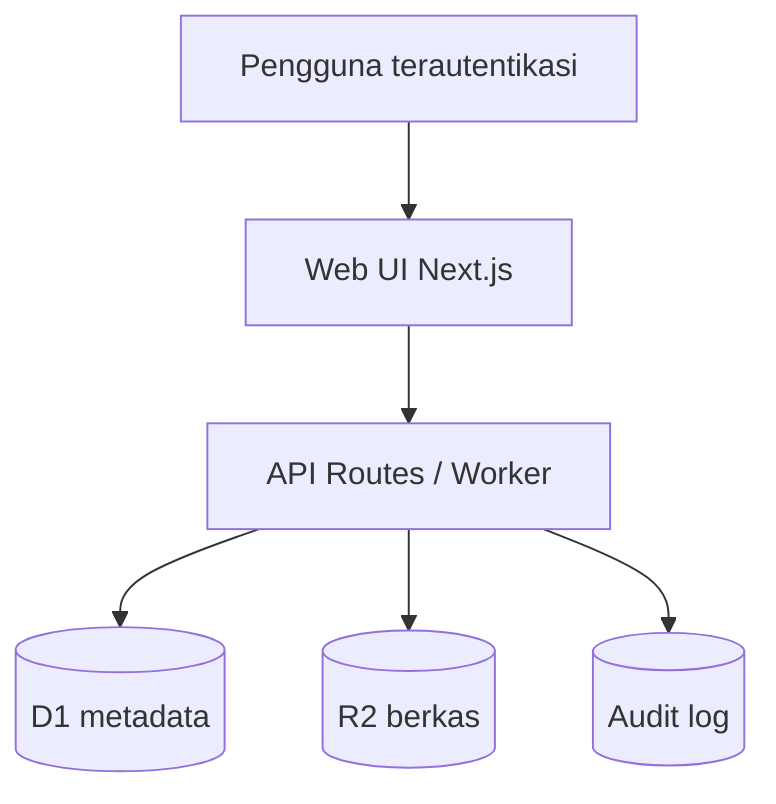

# Arsitektur Teknis

## Gambaran

## Komponen

- **UI:** React client untuk navigasi, pencarian, filter, modal unggah, ekspor, dan dashboard.
- **Server:** Next.js API routes berjalan pada Cloudflare Worker melalui Vinext.
- **Identity:** Header identitas dari ChatGPT Sites; write endpoint menolak permintaan anonim.
- **D1:** metadata arsip, pengguna, klasifikasi, dan audit log.
- **R2:** isi berkas; key menggunakan pola `archives/{tahun}/{uuid}-{nama-aman}`.
- **Drizzle:** definisi skema serta migrasi yang dapat diaudit.

## Model keamanan

1. Situs dipublikasikan privat untuk owner pada fase demo.
2. Endpoint tulis mewajibkan identitas terautentikasi.
3. Berkas tidak menggunakan URL publik; unduhan melewati route aplikasi.
4. Nama berkas dinormalisasi sebelum menjadi object key.
5. Ukuran unggahan dibatasi 25 MB.
6. Secret tidak disimpan dalam repository.

## Keputusan desain

- Data dummy menjadi fallback ketika D1 kosong agar demo selalu dapat digunakan.
- UI memakai single-shell navigation untuk mempertahankan kemiripan dashboard referensi dan navigasi cepat.
- Nama produk menggunakan SIAGA ARSIP; istilah ARSIP TERPADU dipertahankan sebagai nama program perubahan.
- Statistik pada dummy mengikuti gambar referensi dan harus diganti dengan agregasi aktual saat migrasi data.

## Pengembangan berikutnya

- Middleware RBAC server-side untuk setiap operasi.
- Antrean verifikasi khusus.
- Pagination dan full-text search.
- Virus scanning dan OCR asynchronous.
- Backup berkala, retention policy, dan disaster recovery test.
- Observability: error tracking, metrik latensi, serta audit export.
